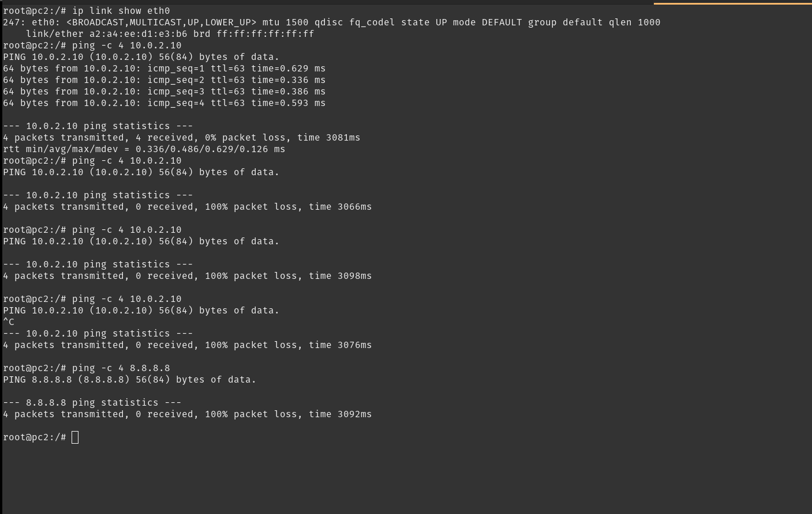
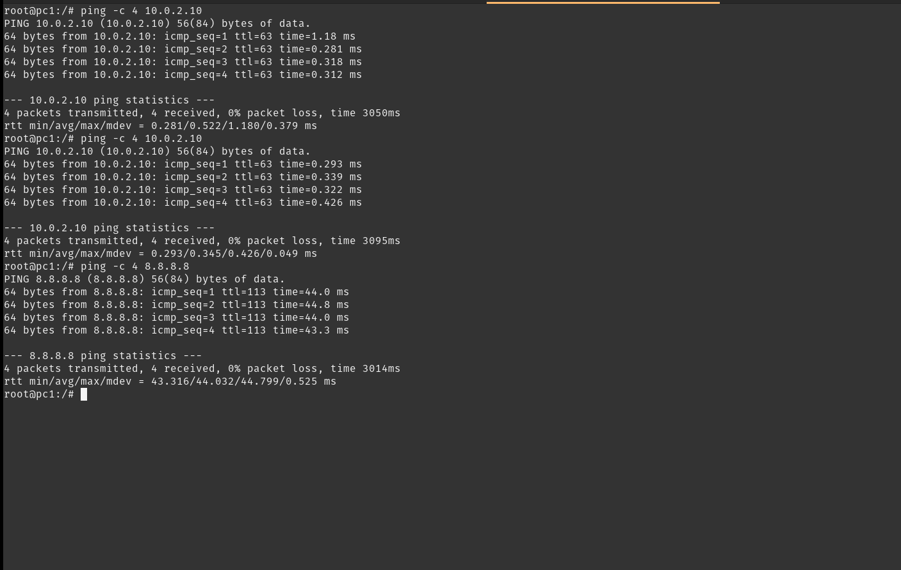
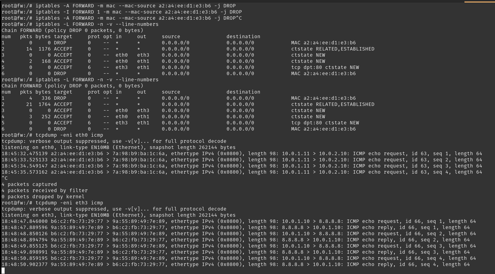

# Evidências — Bloqueio por MAC

O `pc2` (`10.0.1.11`) está na mesma LAN que o `pc1`. A regra foi inserida ao vivo com `iptables -I` e não faz parte do `fw.startup`.

## 1. MAC do pc2 e acesso antes da regra

No `pc2`:

```bash
ip link show eth0
ping -c 4 10.0.2.10
```

A `eth0` está em `a2:a4:ee:d1:e3:b6`. O primeiro `ping` para o `web` (`10.0.2.10`) recebeu os 4 pacotes, com 0% de perda e `ttl=63`. A política de perímetro ainda aceitava sessão nova da LAN para a DMZ.

## 2. Regra

No `fw`, um `-A` colocou o descarte no fim da cadeia, depois dos `ACCEPT`. Esse ponto não bloqueia: o pacote casa antes com a permissão da LAN. O `-I FORWARD 1` põe a mesma condição no topo, para ser avaliada primeiro.

```bash
iptables -I FORWARD 1 -m mac --mac-source a2:a4:ee:d1:e3:b6 -j DROP
iptables -L FORWARD -n -v --line-numbers
```

Na primeira listagem, a regra 1 é `DROP` do MAC `a2:a4:ee:d1:e3:b6`, com contador zero. A regra igual no fim da cadeia é o resto do `-A`.

## 3. pc2 depois da regra

No `pc2`, os `ping` seguintes para `10.0.2.10` e para `8.8.8.8` enviaram 4 pacotes, receberam 0 e terminaram com 100% de perda.



## 4. pc1 não entra na regra

No `pc1` (`10.0.1.10`), com a regra ainda ativa:

```bash
ping -c 4 10.0.2.10
ping -c 4 8.8.8.8
```

Os dois destinos responderam aos 4 pacotes, com 0% de perda. O bloqueio é o MAC de origem do `pc2`, não a saída da LAN.



## 5. Descarte no firewall

No `fw`, a segunda listagem mostra a regra 1 com 4 pacotes e 336 bytes. São os quatro echo requests de um `ping` do `pc2`.

```bash
iptables -L FORWARD -n -v --line-numbers
tcpdump -eni eth0 icmp
tcpdump -eni eth3 icmp
```

Na `eth0`, o `tcpdump` registrou os quatro `ICMP echo request` de `10.0.1.11` para `10.0.2.10`, com MAC de origem `a2:a4:ee:d1:e3:b6`. O kernel marcou os 4 pacotes como descartados pelo filtro.

Na `eth3` não apareceu pacote do `pc2`. O que saiu foi o `pc1` (`10.0.1.10`) para `8.8.8.8`. Nesse enlace o quadro já tem origem `b6:c2:fb:73:29:77`, MAC da `eth3` do firewall, e destino `9a:55:89:49:7e:89`, o próximo salto.



## 6. O MAC não atravessa o firewall

O endereço MAC vale no enlace local. O `fw` enxerga o MAC do `pc2` porque os dois estão no cabo da LAN, na `eth0`. Na `eth3` o quadro é outro: a origem é o MAC do próprio firewall e o destino é o MAC do próximo salto. Se houvesse um roteador entre o `pc2` e o `fw`, a regra veria o MAC desse roteador, não o do `pc2`.
