# Atividade 2 — Squid na saída, NGINX na entrada

Mesma topologia da [atividade 1](../README.md), com dois nós a mais: `proxy` (`10.0.1.20`) na LAN e `rp` (`10.0.2.20`) na DMZ. O Squid fica no caminho de quem sai; o NGINX fica no caminho de quem entra.

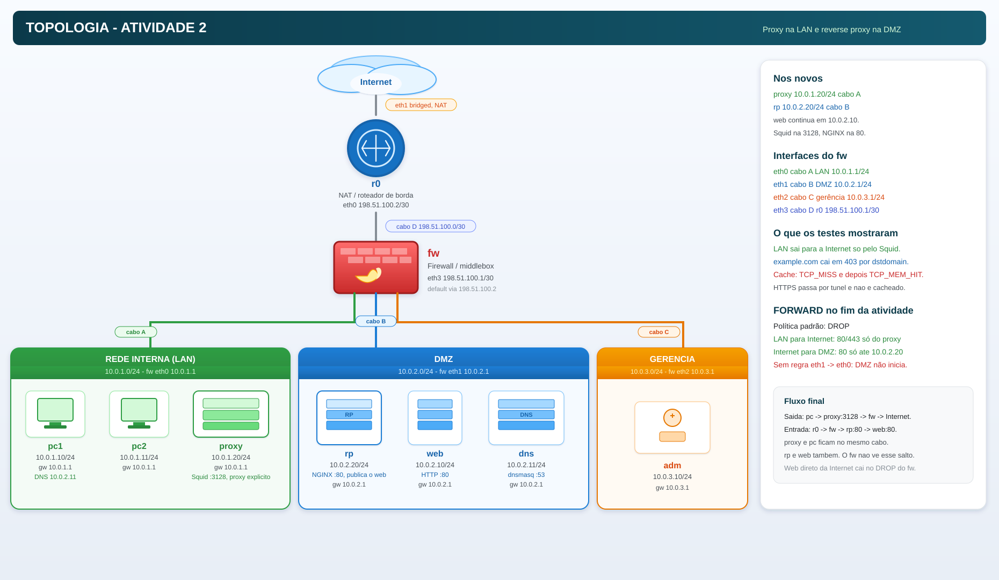

```bash
bash start.sh                              # build das imagens + lclean + lstart
kathara connect pc1                        # ou: kathara lstart --noterminals -d .
```

| Etapa | O que foi testado                              | Evidência                                              |
| ----- | ---------------------------------------------- | ------------------------------------------------------ |
| 1     | tráfego direto antes de qualquer proxy         | [baseline](steps/01-baseline/evidencias.md)            |
| 2     | `proxy` na LAN e `rp` na DMZ                   | [topologia](steps/02-topologia/evidencias.md)          |
| 3     | Squid e NGINX instalados na imagem             | [imagens](steps/03-imagens/evidencias.md)              |
| 4     | LAN só sai para a Internet pelo Squid          | [squid](steps/04-squid/evidencias.md)                  |
| 5     | bloqueio por domínio e leitura do `access.log` | [acls](steps/05-acls-dominio/evidencias.md)            |
| 6     | `TCP_MISS` e `TCP_MEM_HIT` no cache            | [cache](steps/06-cache/evidencias.md)                  |
| 7     | `web` publicado só pelo NGINX                  | [reverse proxy](steps/07-nginx-reverse/evidencias.md)  |
| 8     | `/admin` negado e método limitado              | [controles](steps/08-nginx-controles/evidencias.md)    |
| 10    | `lstart` limpo reproduzindo os serviços        | [reprodução](steps/10-reprodutibilidade/evidencias.md) |

## 1. LAN → Squid → Internet

Sem `-x`, o `pc1` não sai: o `fw` aceita TCP/80 e TCP/443 novos na `FORWARD` só com origem `10.0.1.20`.

```bash
curl -I --max-time 8 http://example.com                                        # timeout
curl -I --max-time 8 -x http://10.0.1.20:3128 http://example.com               # 200 OK
```

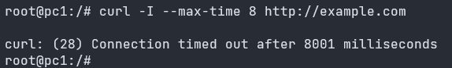
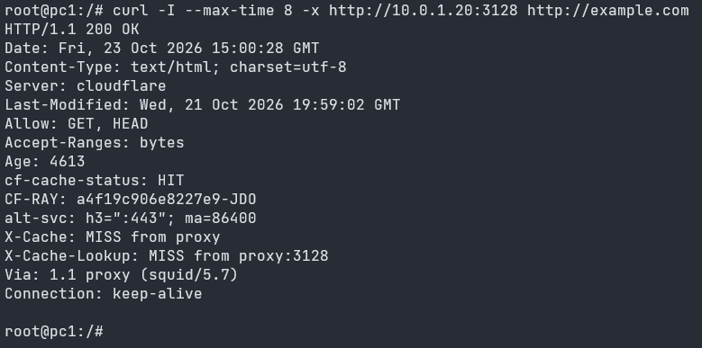

O `Via: 1.1 proxy (squid/5.7)` na resposta marca que o objeto passou pelo Squid. `pc1` e `pc2` recebem o mesmo tratamento: a ACL `lan src 10.0.1.0/24` vale para a rede inteira.

## 2. Bloqueio de domínio pelo Squid

```squid
acl sites_bloqueados dstdomain .example.com
http_access deny sites_bloqueados     # antes do allow lan
```

```bash
curl -sSI -x http://10.0.1.20:3128 http://example.com     # 403 ERR_ACCESS_DENIED
curl -sSI -x http://10.0.1.20:3128 http://info.cern.ch    # 200 OK
```

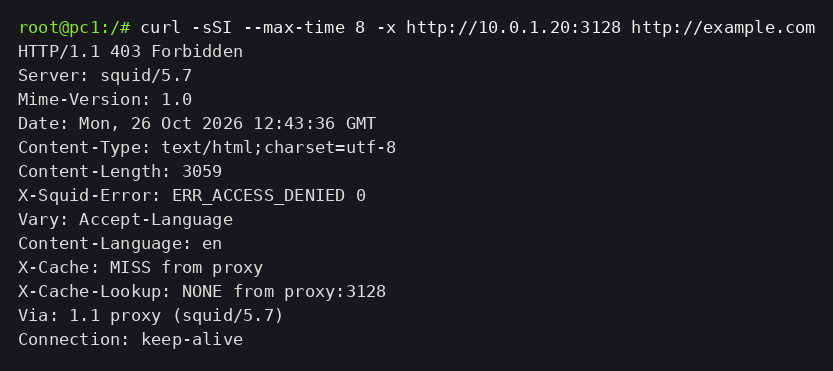
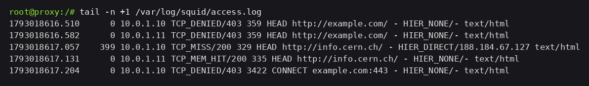

O log é o que fecha a prova: `TCP_DENIED/403` em `example.com` para os dois clientes, `TCP_MISS/200` em `info.cern.ch`, e `TCP_DENIED/403 CONNECT example.com:443` para o HTTPS — o nome do host está em texto puro no `CONNECT`, então a ACL pega mesmo sem ler o conteúdo cifrado.

## 3. Cache

```bash
curl -sS -o /dev/null -x http://10.0.1.20:3128 \
  http://info.cern.ch/hypertext/WWW/TheProject.html      # duas vezes
```

```text
TCP_MISS/200  ... HIER_DIRECT/188.184.67.127     primeira
TCP_MEM_HIT/200 ... HIER_NONE/-                  segunda
```

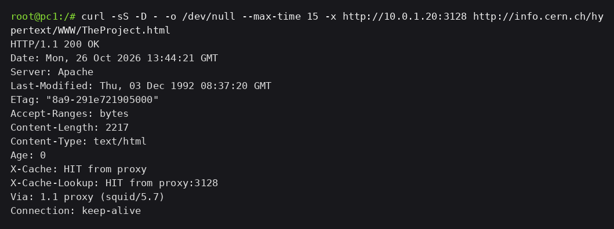

A primeira linha tem `HIER_DIRECT`: o Squid foi buscar na origem. A segunda tem `HIER_NONE`: entregou do cache, sem conexão com ninguém. O `X-Cache` na resposta acompanha, `MISS` e depois `HIT`. HTTPS não entra aqui: dois pedidos ao mesmo arquivo por HTTPS deram `TCP_TUNNEL/200` com os mesmos 8312 bytes cada, porque o proxy só repassa bytes cifrados.

## 4. Internet → NGINX → Web

```bash
curl -sS -D - -o /dev/null http://10.0.2.20     # no r0
```

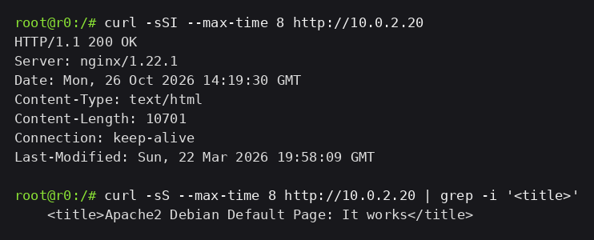

`200 OK` com `Server: nginx` e o `index.html` de 10701 bytes que está no `web`. No log do `web`, o cliente é `10.0.2.20`: a conexão do `r0` termina no `rp`, e o `rp` abre outra até o `web`.

## 5. Acesso direto Internet → Web bloqueado

A liberação larga de TCP/80 para a DMZ virou regra com destino fixo:

```bash
iptables -A FORWARD -i eth3 -o eth1 -p tcp -d 10.0.2.20 --dport 80 \
    -m conntrack --ctstate NEW -j ACCEPT
```

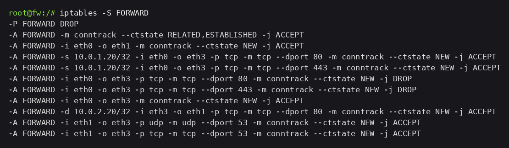
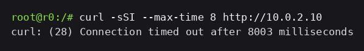

`curl http://10.0.2.10` do `r0` estoura o tempo: `DROP` na política, nenhuma resposta volta. Do próprio `rp`, o `web` continua respondendo `200`, porque `rp` e `web` estão no mesmo cabo B e esse salto não passa pela `FORWARD`.

## 6. Os dois controles do NGINX

```nginx
if ($request_method !~ ^(GET|HEAD)$) { return 405; }
location = /admin { return 403; }
location /admin/  { return 403; }
```

| Pedido do `r0` | Status | Quem respondeu                        |
| -------------- | ------ | ------------------------------------- |
| `GET /`        | 200    | `web` — o `index.html` de 10701 bytes |
| `GET /admin`   | 403    | `rp` — página de erro do NGINX        |
| `POST /`       | 405    | `rp` — página de erro do NGINX        |

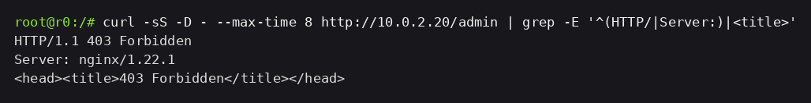
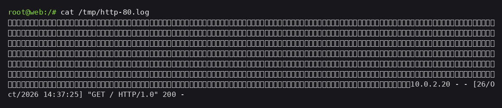

O log do `web` tem uma linha só, `GET / HTTP/1.0 200`. `/admin` e `POST` morreram no `rp`. E dentro da DMZ o `/admin` responde `200` com 228 bytes: ele existe, o que barra é o `rp`.

## 7. Defense in Depth

### As três barreiras não fazem a mesma coisa

|                 | Onde está                                    | Tráfego que observa                     | Informação que usa                               | Se for retirado                                                                      |
| --------------- | -------------------------------------------- | --------------------------------------- | ------------------------------------------------ | ------------------------------------------------------------------------------------ |
| Firewall `fw`   | roteador entre as quatro redes, na `FORWARD` | tudo que cruza de uma zona para outra   | endereço IP, porta, estado da conexão            | as zonas deixam de existir: LAN, DMZ e borda passam a se enxergar                    |
| Squid (forward) | `10.0.1.20`, na LAN, porta 3128              | só o que os clientes da LAN pedem a ele | URL, cabeçalho `Host`, método, nome no `CONNECT` | a LAN volta a sair sozinha: sem política por domínio, sem cache, sem log por estação |
| NGINX (reverse) | `10.0.2.20`, na DMZ, porta 80                | só o que chega ao serviço publicado     | caminho (`/admin`), método, cabeçalhos           | o `web` vira o endereço público, cru, com o que estiver no disco                     |

Cada uma decide com um tipo diferente de informação, porque cada uma está em um ponto diferente: o firewall decide no encaminhamento do pacote, o Squid recebe a URL do cliente, o NGINX recebe a requisição inteira antes de repassar.

Os três continuam porque nenhum cobre o trabalho do outro. Trocar o firewall por um proxy deixaria sem dono o que não é requisição HTTP: o roteamento entre as redes, a separação de zonas e o bloqueio de sessão nova da DMZ para a LAN, que existe hoje porque a `FORWARD` não tem nenhuma regra `eth1 → eth0` e a política é `DROP`.

### Cenário 1 — o firewall reabre o HTTP para a DMZ

Duas falhas separadas. Quem entrar pelo `rp` continua sujeito aos mesmos controles: `GET /admin` devolve `403` e `POST /` devolve `405`, gerados antes de qualquer encaminhamento, e o log do `web` continua registrando só o que passou. Reabrir o firewall não muda isso.

Acesso direto ao `web` precisa de duas condições juntas: a regra larga, que aceite pacote novo para qualquer endereço da DMZ, e o `10.0.2.10` alcançável por quem ataca. Com a regra restrita a `-d 10.0.2.20`, o pacote para `10.0.2.10` cai no `DROP`. Reestabelecida a regra larga, o `web` responde cru — `python3 -m http.server` serve o que está no disco, `/admin` incluso — e todo o controle de aplicação fica para trás, porque o NGINX não está naquele caminho.

### Cenário 2 — o `web` foi comprometido

O atacante já está dentro da DMZ. O que continua valendo é o firewall: sem regra `eth1 → eth0`, sessão nova do `web` para `10.0.1.0/24` cai no `DROP` e o `pc1` não recebe.

O Squid não aparece nesse caminho. Ele atende cliente da LAN que pede um destino externo; nada em `web → LAN` passa por ele, e ele não nega o que não lhe foi pedido.

O NGINX também não salva nada aqui. Ele controla exposição do serviço — quem entra, por qual endereço, por qual caminho, com qual método. Contra um servidor já dominado, o que ele controla está do lado errado.

Ressalvas que o próprio lab mostra: `LAN → DMZ` tem regra nova aceita em qualquer porta, então um `web` dominado conversa com o `pc1` respondendo a sessão que o próprio `pc1` abriu (iniciar a conexão ele não consegue); `web`, `dns` e `rp` estão no mesmo cabo B sem nada entre eles; e a `FORWARD` aceita do `web` saída para a Internet na porta 53.

### Limites de cada camada

O firewall não distingue domínio nem URL: `GET /`, `GET /admin` e `POST /` são idênticos em L3/L4 — TCP/80, mesma origem, mesmo destino. O Squid não separa zonas: é um host a mais na LAN, e sem o firewall ele continua existindo enquanto as zonas deixam de existir. O NGINX não impede o `web` de iniciar conexão própria: ele responde ao que chega na porta 80.

A barreira útil depende de onde o atacante está. Fora da rede, firewall e NGINX. Na DMZ, firewall. Na LAN, firewall e Squid, e o Squid só decide o que for pedido a ele.

## Como aprendemos

| Dúvida ou problema                                | Fonte                                           | O que ficou claro                                                                      | Como o laboratório validou                                                                                        |
| ------------------------------------------------- | ----------------------------------------------- | -------------------------------------------------------------------------------------- | ----------------------------------------------------------------------------------------------------------------- |
| Onde colocar `http_access deny sites_bloqueados`  | manual do Squid (`squid.conf.access`)           | `http_access` é avaliada em ordem e para na primeira que casar                         | `TCP_DENIED/403` em `example.com` e `TCP_MISS/200` em `info.cern.ch` no mesmo log                                 |
| `dstdomain .example.com` pega subdomínio?         | manual do Squid                                 | o ponto inicial casa domínio e subdomínios                                             | `www.example.com` pelo proxy também devolveu `403`                                                                |
| HEAD entra no cache?                              | manual do Squid + leitura do log                | o log distingue `TCP_MISS`, `TCP_HIT`, `TCP_MEM_HIT`                                   | com `GET`, primeira linha `TCP_MISS/200`, segunda `TCP_MEM_HIT/200`                                               |
| Por que HTTPS não é cacheado?                     | documentação de SSL Bump do Squid               | sem interceptação o proxy só repassa o túnel                                           | dois pedidos HTTPS deram `TCP_TUNNEL/200` com 8312 bytes cada                                                     |
| Como negar método sem quebrar o resto?            | documentação do NGINX sobre `if` e `location`   | `return` dentro de `if` é uso seguro; localização exata vence prefixo                  | `POST /` → `405`, `GET /admin` → `403`, `GET /` seguiu `200`                                                      |
| Por que não existe regra `rp → web` na `FORWARD`? | documentação do Kathará (collision domain = L2) | `FORWARD` só vê pacote que cruza interface                                             | `rp → web` responde `200` sem nenhuma regra; `r0 → web` cai no `DROP`                                             |
| Como instalar Squid e NGINX de forma persistente? | documentação do Kathará (pasta do nó, imagens)  | a pasta com o nome do nó é copiada no start; `Dockerfile` dentro dela não é construído | `apt install` no terminal sumiu no `lclean`; com imagem declarada no `lab.conf`, os binários voltaram no `lstart` |
| Como trocar uma regra sem reordenar a cadeia?     | `iptables(8)`, opção `-R`                       | `-R FORWARD n` substitui na posição                                                    | `iptables -S FORWARD` mostra a cadeia com a mesma ordem e a regra nova no lugar                                   |

### Reflexão

**O que tivemos que aprender por conta própria.** Os conceitos de firewall, proxy e proxy reverso, o papel de cada um e a diferença entre eles. Também como preparar o Kathará para os dois serviços: imagem do nó, arquivo de configuração copiado no `lstart` e o processo subindo no `.startup`.

**A fonte mais útil.** O YouTube. Dá para ver, com exemplo, o que cada um dos três faz e onde entra no caminho do pacote. Texto de manual explica a diretiva; o vídeo mostra a diferença entre encaminhar uma zona, buscar um site para o cliente e publicar um serviço.

**Solução de fora que não funcionou.** A implementação de cada etapa foi guiada com GenAI. No conjunto, a configuração sugerida funcionou no laboratório: o acesso pelo Squid, o bloqueio de domínio, o cache, o NGINX e os dois controles fecharam com o log e com o código HTTP que a etapa pedia.

**O que faríamos diferente.** Antes de subir a topologia desenhada na atividade, a gente pararia para perguntar se aquele desenho é o adequado ou se dá para melhorar. Agora o papel de cada nó está mais claro, e essa pergunta viria antes do `lab.conf`.
