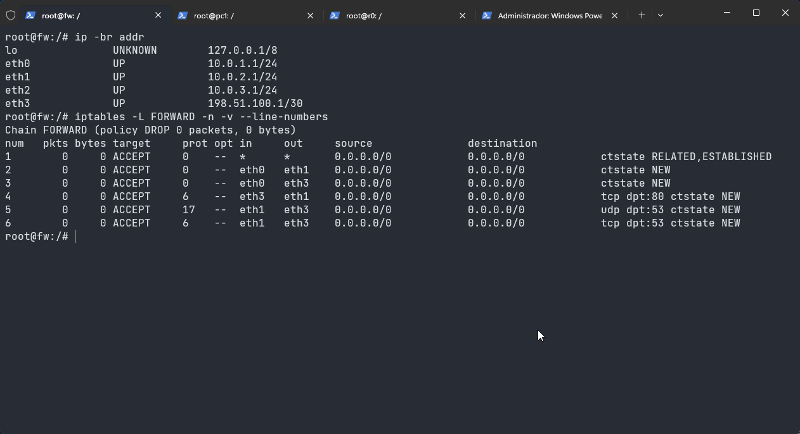
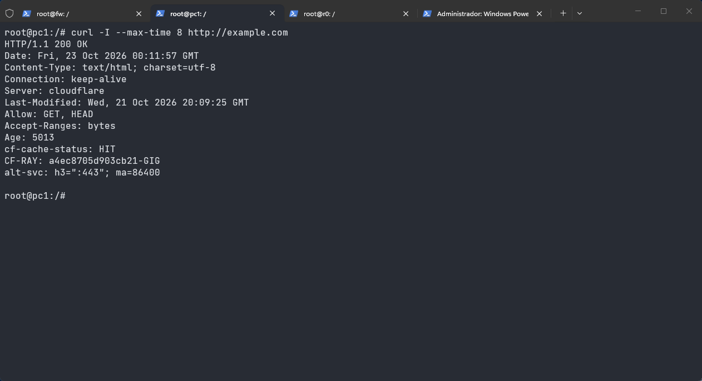
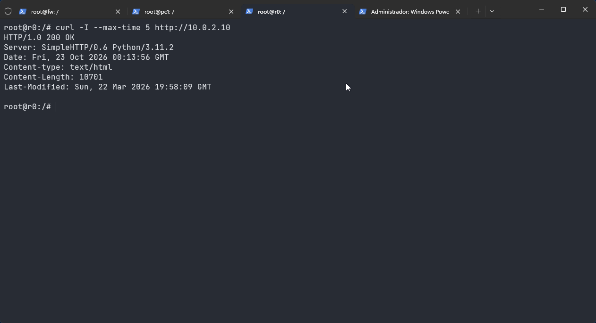

# Evidências — Baseline da atividade 2

Registro do laboratório da atividade 1 antes de acrescentar o Squid e o NGINX. Nenhum nó novo existe ainda. As regras de L2, L3 e L4 não fazem parte desta subida: elas foram aplicadas ao vivo na atividade anterior e não estão no `fw.startup`.

## 1. Interfaces e política do firewall

No `fw`:

```bash
ip -br addr
iptables -L FORWARD -n -v --line-numbers
```

As interfaces subiram como no plano:

- `eth0` LAN `10.0.1.1/24`
- `eth1` DMZ `10.0.2.1/24`
- `eth2` gerência `10.0.3.1/24`
- `eth3` enlace com o `r0` `198.51.100.1/30`

A cadeia `FORWARD` está com política `DROP` e seis regras, todas com contador zero. A listagem foi feita antes dos testes de acesso.

```text
1  ACCEPT  *    *     ctstate RELATED,ESTABLISHED
2  ACCEPT  eth0 eth1  ctstate NEW
3  ACCEPT  eth0 eth3  ctstate NEW
4  ACCEPT  eth3 eth1  tcp dpt:80 ctstate NEW
5  ACCEPT  eth1 eth3  udp dpt:53 ctstate NEW
6  ACCEPT  eth1 eth3  tcp dpt:53 ctstate NEW
```



A regra 3 é a saída da LAN para a Internet sem proxy. A regra 4 libera TCP/80 vindo da Internet para qualquer host da DMZ. É essa regra que a atividade 2 vai restringir ao NGINX.

## 2. LAN para a Internet, sem proxy

No `pc1`, sem a opção `-x`:

```bash
curl -I --max-time 8 http://example.com
```

A resposta foi `HTTP/1.1 200 OK`, servida pela Cloudflare. O `pc1` usou o gateway `10.0.1.1`, o firewall encaminhou pela regra 3 e o `r0` fez o NAT.



## 3. Internet direto no web

No `r0`:

```bash
curl -I --max-time 5 http://10.0.2.10
```

A resposta foi `HTTP/1.0 200 OK`, com `Server: SimpleHTTP/0.6 Python/3.11.2`. O pacote entrou pela `eth3`, saiu pela `eth1` e casou com a regra 4. O servidor Web da DMZ está exposto direto à Internet.


