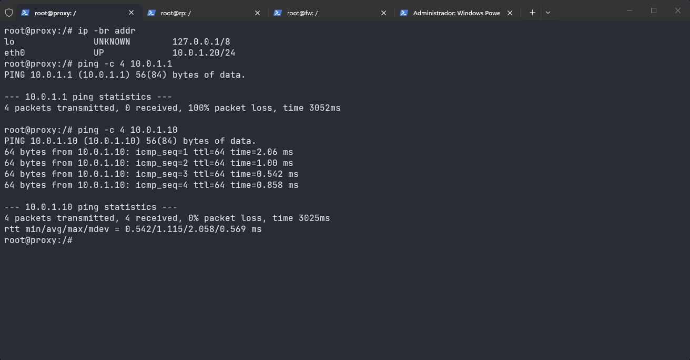
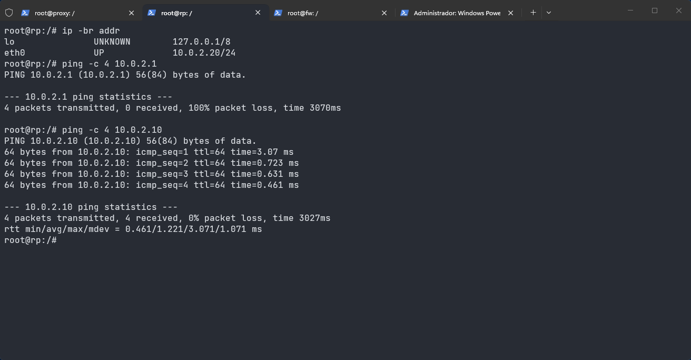

# Evidências — Topologia com proxy e rp

O `proxy` entrou na LAN (cabo A) e o `rp` entrou na DMZ (cabo B). Os `.startup` só configuram endereço e gateway. Squid e NGINX ainda não estão instalados.

| Nó | Endereço | Gateway |
| --- | --- | --- |
| `proxy` | `10.0.1.20/24` | `10.0.1.1` (`fw` eth0) |
| `rp` | `10.0.2.20/24` | `10.0.2.1` (`fw` eth1) |

## 1. proxy na mesma LAN que o pc1

No `proxy`, a `eth0` subiu em `10.0.1.20/24`.

O `ping` para `10.0.1.1` terminou com 100% de perda. Esse endereço é a própria placa do firewall, e a cadeia `INPUT` do `fw` está em `DROP`. O pacote chega ao `fw` e é descartado ali.

O `ping` para o `pc1` (`10.0.1.10`) recebeu os 4 pacotes, com 0% de perda e `ttl=64`. O `proxy` e o `pc1` estão no cabo A, então o pacote não passa pelo firewall.



## 2. rp na mesma DMZ que o web

No `rp`, a `eth0` subiu em `10.0.2.20/24`.

O `ping` para `10.0.2.1` também teve 100% de perda, pelo mesmo motivo: o destino é o firewall e a `INPUT` descarta o ICMP.

O `ping` para o `web` (`10.0.2.10`) recebeu os 4 pacotes, com 0% de perda e `ttl=64`. O `rp`, o `web` e o `dns` estão no cabo B.



## 3. Contador da INPUT

Depois desses pings, no `fw`:

```text
Chain INPUT (policy DROP 16 packets, 1344 bytes)
```

16 pacotes de 84 bytes são os dois testes de 4 pings ao gateway, repetidos uma vez em cada nó. Nenhuma regra da `INPUT` aceita ICMP. A `FORWARD` não entra nessa conta.
