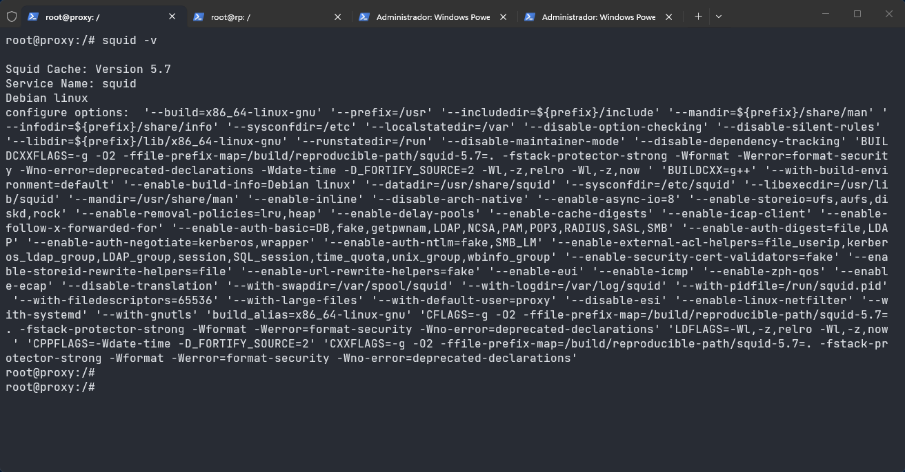
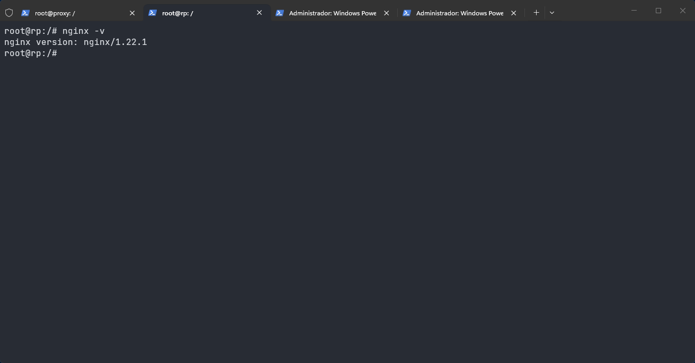

# Evidências — Squid e NGINX persistidos na imagem

O `apt install` feito só no terminal do container some no `lclean`. A pasta com o nome da máquina é copiada para dentro do sistema de arquivos; um `Dockerfile` colocado nela não é construído.

A imagem foi construída fora dessa pasta e declarada no `lab.conf`:

```text
proxy[image]="kathara/proxy-squid"
rp[image]="kathara/rp-nginx"
```

O contexto do `docker build` é `images/proxy` e `images/rp`. As duas imagens partem de `kathara/base` e instalam só o pacote do serviço. Depois do `lclean` e de um novo `lstart`, os binários já estavam nos containers, sem instalação manual.

`-v` imprime a versão e encerra. Nenhum dos dois processos está escutando ainda.

## 1. Squid no proxy

No `proxy`:

```bash
squid -v
```

A primeira linha da saída foi `Squid Cache: Version 5.7`, pacote Debian, com configuração em `/etc/squid`.



## 2. NGINX no rp

No `rp`:

```bash
nginx -v
```

A saída foi `nginx version: nginx/1.22.1`.


