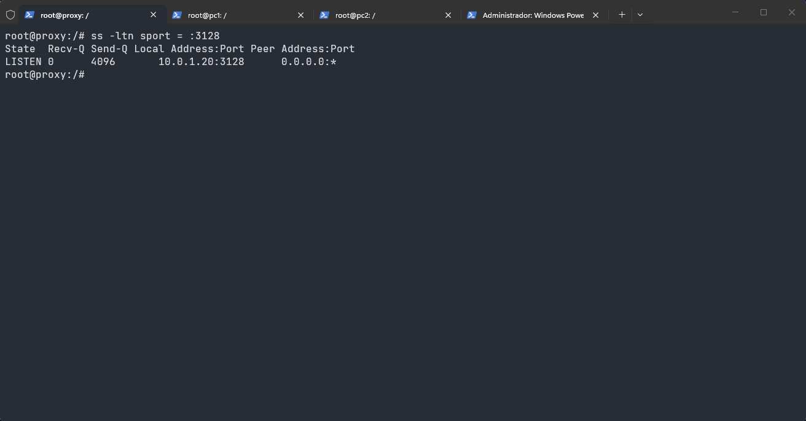
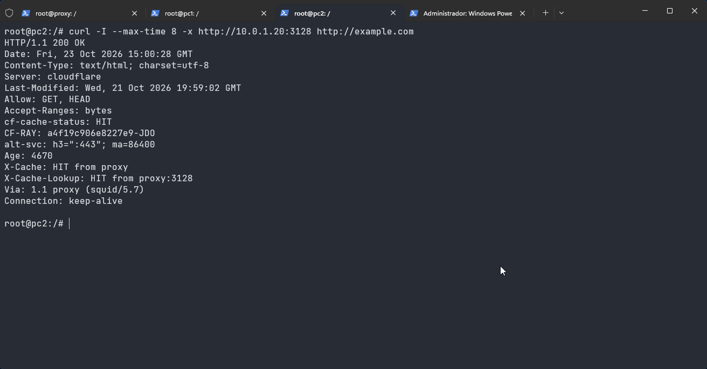

# Evidências — Squid como forward proxy

O Squid escuta em `10.0.1.20:3128` e a ACL `lan` libera `10.0.1.0/24`. O cliente pede o recurso ao proxy. O pacote do `pc` até o Squid fica no cabo A e não passa pela `FORWARD`.

Quem sai para a Internet é o Squid, com origem `10.0.1.20`. No `fw`, TCP/80 e TCP/443 novos de `eth0` para `eth3` só são aceitos com essa origem. O restante da LAN cai no `DROP` dessas duas portas. ICMP e os outros protocolos continuam como na atividade 1.

## 1. Porta do proxy

No `proxy`:

```bash
ss -ltn sport = :3128
```

A saída mostra `LISTEN` em `10.0.1.20:3128`.



## 2. Acesso direto bloqueado

No `pc1`, sem `-x`:

```bash
curl -I --max-time 8 http://example.com
```

O comando terminou com `curl: (28) Connection timed out after 8001 milliseconds`. Não houve resposta HTTP. O TCP/80 saiu de `10.0.1.10` e o firewall descartou.


## 3. pc1 pelo proxy

No `pc1`:

```bash
curl -I --max-time 8 -x http://10.0.1.20:3128 http://example.com
```

A resposta foi `HTTP/1.1 200 OK`. O cabeçalho `Via: 1.1 proxy (squid/5.7)` mostra que a resposta passou pelo Squid. `X-Cache: MISS from proxy` é a primeira busca: o Squid não tinha o objeto e foi buscá-lo na Internet.

`cf-cache-status: HIT` é o cache da Cloudflare, não o do laboratório.


## 4. pc2 pelo mesmo proxy

No `pc2`, o mesmo `curl` com `-x`.

A resposta também foi `HTTP/1.1 200 OK`, com o mesmo `Via`. `X-Cache: HIT from proxy` é a segunda busca: o Squid entregou a cópia guardada no pedido do `pc1`. A ACL vale para a rede inteira, não para um único cliente.


