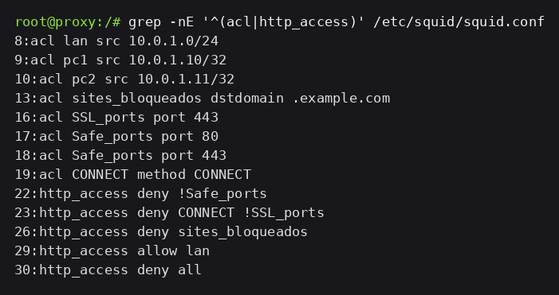
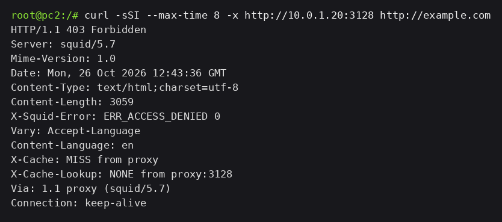
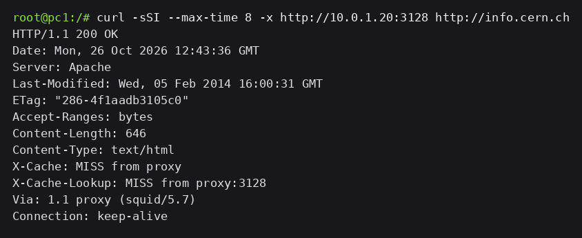
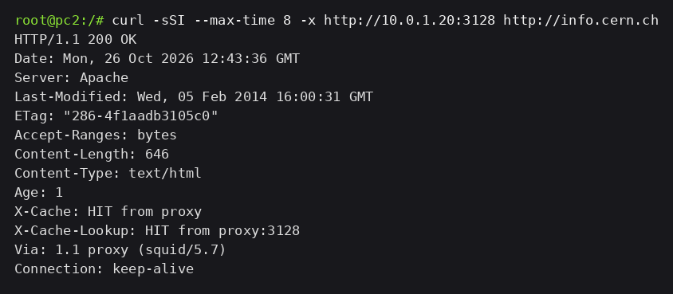
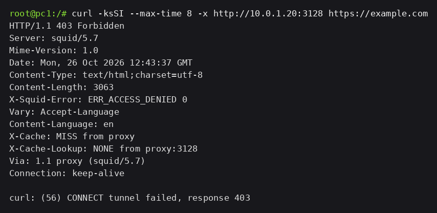

# Evidências — ACLs, Cliente e Bloqueio por Domínio

O Squid (`10.0.1.20`) passa a decidir por nome de domínio, além de identificar o cliente pelo IP de origem. Domínio proibido: `example.com`. Domínio permitido: `info.cern.ch`, que serve HTTP puro e não depende de HTTPS para o teste.

## 1. Configuração do Squid (`squid.conf`)

No arquivo `proxy/etc/squid/squid.conf`:

```squid
# Quem pode usar o proxy. Primeira regra que casa decide.
acl lan src 10.0.1.0/24
acl pc1 src 10.0.1.10/32
acl pc2 src 10.0.1.11/32

# ACL de destino por domínio (o ponto inicial casa com o domínio e subdomínios)
acl sites_bloqueados dstdomain .example.com

# Bloqueio por domínio (deve vir ANTES de liberar a LAN)
http_access deny sites_bloqueados

# A LAN passa para os demais destinos. Qualquer outra origem para aqui.
http_access allow lan
http_access deny all
```

As demais diretivas do arquivo (portas seguras, `CONNECT`) vieram da etapa anterior e não mudaram.

O `http_access deny sites_bloqueados` está acima do `allow lan` de propósito. O Squid avalia as regras em ordem e para na primeira que casa: se a LAN fosse liberada antes, a requisição nunca chegaria na regra de bloqueio.

No nó `proxy`, o arquivo carregado em `/etc/squid/squid.conf`:

```bash
grep -nE '^(acl|http_access)' /etc/squid/squid.conf
```



## 2. Domínio proibido

No `pc1`:

```bash
curl -sSI --max-time 8 -x http://10.0.1.20:3128 http://example.com
```

```text
HTTP/1.1 403 Forbidden
Server: squid/5.7
X-Squid-Error: ERR_ACCESS_DENIED 0
```


No `pc2`, o mesmo comando, mesma resposta. A ACL vale para a rede inteira, não para um cliente só.



O Squid respondeu a negação e não encaminhou nada para a Internet.

## 3. Domínio permitido

No `pc1`:

```bash
curl -sSI --max-time 8 -x http://10.0.1.20:3128 http://info.cern.ch
```

```text
HTTP/1.1 200 OK
Server: Apache
X-Cache: MISS from proxy
Via: 1.1 proxy (squid/5.7)
```



No `pc2`, o mesmo comando devolve `200 OK` com `X-Cache: HIT`: o Squid entregou a cópia que já tinha pego no pedido do `pc1`.



## 4. HTTPS e o método CONNECT

```bash
curl -ksSI --max-time 8 -x http://10.0.1.20:3128 https://example.com
```

```text
HTTP/1.1 403 Forbidden
X-Squid-Error: ERR_ACCESS_DENIED 0
curl: (56) CONNECT tunnel failed, response 403
```



O cliente pediu um túnel com `CONNECT example.com:443`. O nome do host está em texto puro nessa linha do pedido, então o Squid aplicou a ACL antes de abrir o túnel.

## 5. O que ficou no `access.log`

Zeramos o log e limpamos o cache antes da rodada, para as cinco linhas abaixo serem exatamente os cinco comandos desta página:

```bash
truncate -s 0 /var/log/squid/access.log
squid -z -N
```

```text
1793018616.510      0 10.0.1.10 TCP_DENIED/403 359 HEAD http://example.com/ - HIER_NONE/- text/html
1793018616.582      0 10.0.1.11 TCP_DENIED/403 359 HEAD http://example.com/ - HIER_NONE/- text/html
1793018617.057    399 10.0.1.10 TCP_MISS/200 329 HEAD http://info.cern.ch/ - HIER_DIRECT/188.184.67.127 text/html
1793018617.131      0 10.0.1.11 TCP_MEM_HIT/200 335 HEAD http://info.cern.ch/ - HIER_NONE/- text/html
1793018617.204      0 10.0.1.10 TCP_DENIED/403 3422 CONNECT example.com:443 - HIER_NONE/- text/html
```


Cada linha traz o IP do cliente, a ação com o código HTTP, o método e o destino. Nas duas primeiras aparece `10.0.1.10` e `10.0.1.11` com `TCP_DENIED/403`: é a ACL de domínio negando, e o destino continua escrito como `http://example.com/` mesmo com a requisição recusada. Na última linha, o destino aparece como `example.com:443` porque ali o que o proxy recebeu foi um `CONNECT`, não uma URL.

## 6. Comparação com a regra `-d 8.8.8.8` da atividade anterior

- O `iptables` na cadeia `FORWARD` decide por IP e porta. Ele não sabe qual site existe atrás daquele endereço.
- Um mesmo site pode responder por muitos IPs, e um mesmo IP pode servir muitos sites. Bloquear por endereço, num site atrás de CDN, acerta vizinhos inocentes ou falha quando o DNS devolve outro IP.
- O proxy explícito recebe o nome que o cliente pediu: no HTTP está na própria URL e no cabeçalho `Host`; no HTTPS está na linha `CONNECT host:443`. Por isso a ACL `dstdomain` funciona nos dois casos.
- Sem interceptação TLS o Squid para aí. Ele não vê o caminho (`/admin`, `/publico`), os cabeçalhos internos nem o corpo de uma requisição HTTPS — só o domínio. Quer dizer: bloqueio por domínio funciona, bloqueio por página de um site HTTPS não.
- O efeito também é diferente para quem está do outro lado. O `DROP` do firewall vira timeout no navegador; o Squid devolve `403 Forbidden`, que o navegador mostra como página de acesso negado.
