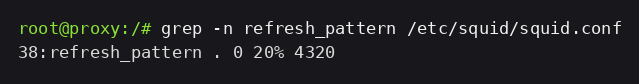
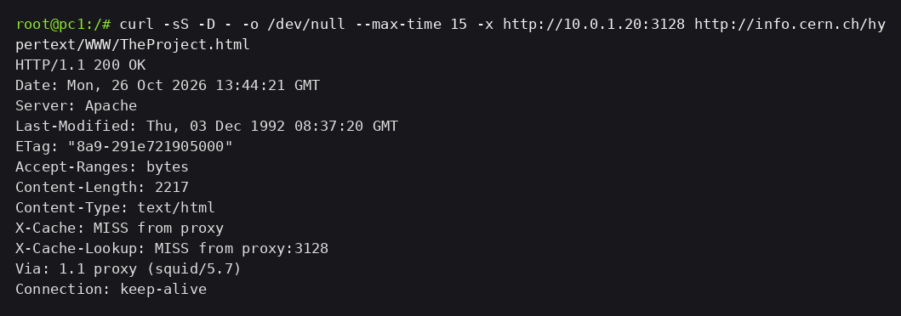
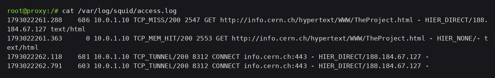
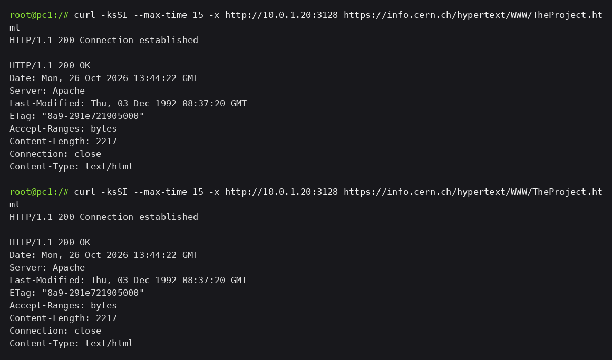

# Evidências — Cache do Squid

O teste usa um URL HTTP estável, `http://info.cern.ch/hypertext/WWW/TheProject.html`, pedido duas vezes pelo proxy. A primeira busca vai até a origem, a segunda sai do cache, e as duas linhas de log mostram isso.

## 1. O que autoriza guardar

O `squid.conf` tem uma única regra de frescor, no fim do arquivo:

```bash
grep -n refresh_pattern /etc/squid/squid.conf
```

```squid
refresh_pattern . 0 20% 4320
```

A resposta do `info.cern.ch` não traz `Cache-Control` nem `Expires`. Sem instrução do servidor, o Squid usa a heurística da regra: guarda por 20% do tempo decorrido desde o `Last-Modified`, com teto de 4320 minutos. Um objeto com `Cache-Control: no-store`, ou revalidado a cada pedido, não passaria por aqui.



## 2. Duas requisições ao mesmo URL

No `pc1`, a primeira vez:

```bash
curl -sS -D - -o /dev/null --max-time 15 -x http://10.0.1.20:3128 \
  http://info.cern.ch/hypertext/WWW/TheProject.html
```

```text
HTTP/1.1 200 OK
Last-Modified: Thu, 03 Dec 1992 08:37:20 GMT
Content-Length: 2217
X-Cache: MISS from proxy
X-Cache-Lookup: MISS from proxy:3128
Via: 1.1 proxy (squid/5.7)
```



No `pc1`, o mesmo comando outra vez:

```text
HTTP/1.1 200 OK
Last-Modified: Thu, 03 Dec 1992 08:37:20 GMT
Content-Length: 2217
Age: 0
X-Cache: HIT from proxy
X-Cache-Lookup: HIT from proxy:3128
Via: 1.1 proxy (squid/5.7)
```


O `Content-Length` é o mesmo e o objeto é o mesmo, mas a segunda resposta tem `Age` e `X-Cache: HIT`: saiu do cache local. `Via` aparece nas duas porque o cliente fala com o Squid em qualquer caso. O que muda é o outro lado: na primeira requisição o Squid abre conexão com `188.184.67.127`, na segunda ele não conecta em nada — a conexão do cliente até o proxy e a do proxy até a origem são independentes.

## 3. As duas linhas no access.log

Com log e cache zerados antes da rodada, o arquivo ficou com exatamente as quatro requisições desta página:

```text
1793022261.288    686 10.0.1.10 TCP_MISS/200 2547 GET http://info.cern.ch/hypertext/WWW/TheProject.html - HIER_DIRECT/188.184.67.127 text/html
1793022261.363      0 10.0.1.10 TCP_MEM_HIT/200 2553 GET http://info.cern.ch/hypertext/WWW/TheProject.html - HIER_NONE/- text/html
1793022262.118    681 10.0.1.10 TCP_TUNNEL/200 8312 CONNECT info.cern.ch:443 - HIER_DIRECT/188.184.67.127 -
1793022262.791    603 10.0.1.10 TCP_TUNNEL/200 8312 CONNECT info.cern.ch:443 - HIER_DIRECT/188.184.67.127 -
```



A primeira linha é `TCP_MISS/200` com `HIER_DIRECT/188.184.67.127`: o Squid não tinha o objeto e foi buscá-lo. A segunda é `TCP_MEM_HIT/200` com `HIER_NONE/-`: serviu do cache, sem consulta à origem. É o `TCP_HIT` de sempre, com a variante de o objeto ainda estar na memória de cache em vez de ser lido do disco.

## 4. Por que site HTTPS não serve para este teste

O mesmo arquivo, pedido por HTTPS, duas vezes:

```bash
curl -ksSI --max-time 15 -x http://10.0.1.20:3128 \
  https://info.cern.ch/hypertext/WWW/TheProject.html
```



As duas requisições aparecem no log como `TCP_TUNNEL/200`, com os mesmos 8312 bytes trafegados em cada uma. Nada foi aproveitado da primeira para a segunda. O Squid estabeleceu `CONNECT info.cern.ch:443` e repassou bytes opacos: ele não vê o objeto, não sabe o que é, e não tem o que guardar. Repare que as respostas tuneladas voltam sem `Via` e sem `X-Cache` — o proxy não participa da conversa HTTP ali dentro.

Para cachear HTTPS seria preciso o SSL Bump: o Squid interceptaria o TLS, terminaria a conexão cifrada do cliente e abriria outra com a origem, passando a ver o conteúdo. Isso exige certificado do proxy instalado nas máquinas clientes, o que muda o laboratório de proxy explícito para inspeção TLS.
