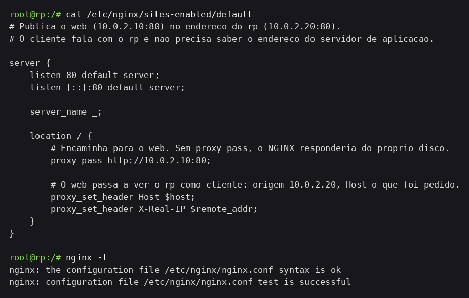
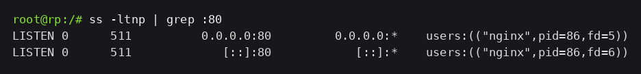
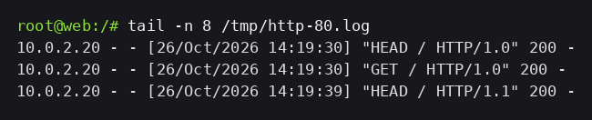
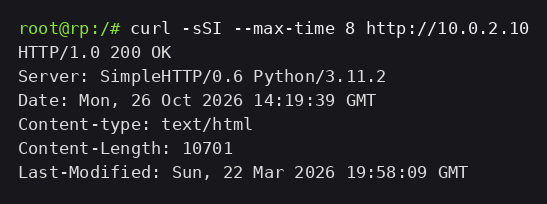

# Evidências — NGINX como reverse proxy

O `web` (`10.0.2.10`) continua servindo `/var/www/html` com `python3 -m http.server 80`, como na etapa 1. O que muda é quem responde à Internet: o `rp` (`10.0.2.20`) assume a porta 80 e encaminha para dentro, e o firewall deixa de aceitar pacote novo destinado ao `web`.

## 1. NGINX no rp

O site fica em `rp/etc/nginx/sites-enabled/default`, copiado para o container no `lstart`, e o `rp.startup` ganhou `nginx` para subir o serviço:

```nginx
server {
    listen 80 default_server;
    listen [::]:80 default_server;
    server_name _;

    location / {
        # Encaminha para o web. Sem proxy_pass, o NGINX responderia do proprio disco.
        proxy_pass http://10.0.2.10:80;

        # O web passa a ver o rp como cliente: origem 10.0.2.20, Host o que foi pedido.
        proxy_set_header Host $host;
        proxy_set_header X-Real-IP $remote_addr;
    }
}
```





## 2. r0 → rp → web

No `r0`, que é o lado de fora da rede:

```bash
curl -sSI --max-time 8 http://10.0.2.20
curl -sS --max-time 8 http://10.0.2.20 | grep -i '<title>'
```

```text
HTTP/1.1 200 OK
Server: nginx/1.22.1
Content-Length: 10701
Last-Modified: Sun, 22 Mar 2026 19:58:09 GMT

    <title>Apache2 Debian Default Page: It works</title>
```


O cliente pediu o endereço do `rp` e recebeu o arquivo do `web`: os 10701 bytes e o `Last-Modified` são os do `index.html` que está no `web`. `Server` e `Date` são reescritos pelo `rp`; o corpo e o `Last-Modified` vieram do `web`.

No `web`, o log do servidor mostra de quem é a requisição:

```text
10.0.2.20 - - [26/Oct/2026 14:19:30] "HEAD / HTTP/1.0" 200 -
10.0.2.20 - - [26/Oct/2026 14:19:30] "GET / HTTP/1.0" 200 -
```



Nenhum endereço da Internet aparece ali: a conexão do `r0` termina no `rp`, e o `rp` abre outra até o `web`. Por isso o `web` só conhece o `10.0.2.20`. O `HTTP/1.0` no log é o NGINX falando com o upstream — sem `proxy_http_version 1.1`, ele usa 1.0 com a origem.

## 3. A regra no firewall

Antes a liberação era `eth3 → eth1` na porta 80 para qualquer destino da DMZ. Agora o destino é o endereço do `rp`:

```bash
iptables -A FORWARD \
    -i eth3 -o eth1 \
    -p tcp -d 10.0.2.20 --dport 80 \
    -m conntrack --ctstate NEW \
    -j ACCEPT
```


Não existe regra `rp → web` na `FORWARD` porque esse tráfego não é encaminhado: `rp` e `web` estão no mesmo cabo B, o pacote vai direto pelo switch e nunca entra no firewall. A `FORWARD` só vê o que cruza de uma interface para outra, e ali só entra o pacote do `r0` até o `rp`.

## 4. Acesso direto ao web

No `r0`, o mesmo pedido agora para `10.0.2.10`:

```bash
curl -sSI --max-time 8 http://10.0.2.10
```

```text
curl: (28) Connection timed out after 8003 milliseconds
```


Sem regra aceitando, o pacote cai no `DROP` da política padrão: nenhuma resposta volta, e o cliente só percebe quando o próprio tempo acaba. É diferente de conexão recusada, que chega na hora — um `REJECT`, ou um serviço que não está escutando, devolve RST e o `curl` encerra em milissegundos com `Connection refused`. Aqui o `web` está de pé e respondendo, tanto que do próprio `rp` ele ainda atende:

```bash
curl -sSI --max-time 8 http://10.0.2.10   # no rp
```

```text
HTTP/1.0 200 OK
Server: SimpleHTTP/0.6 Python/3.11.2
```


