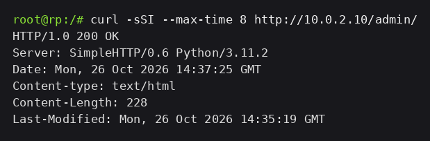
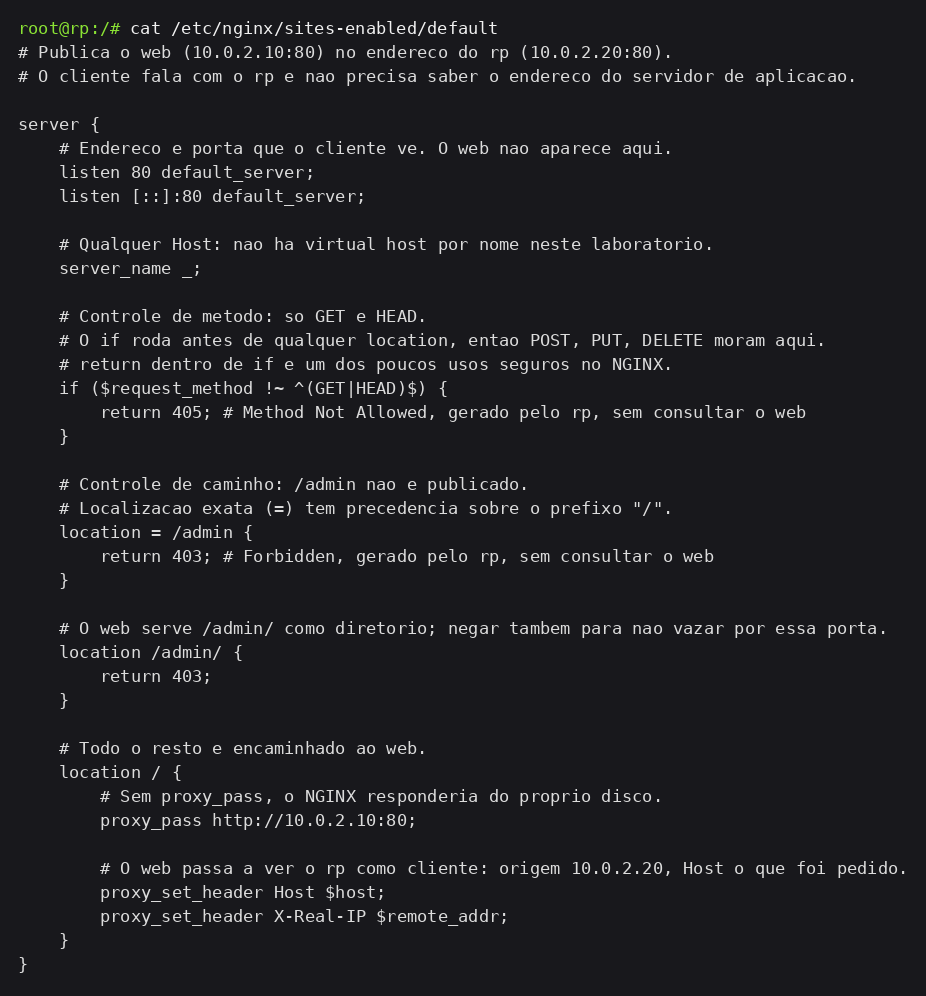
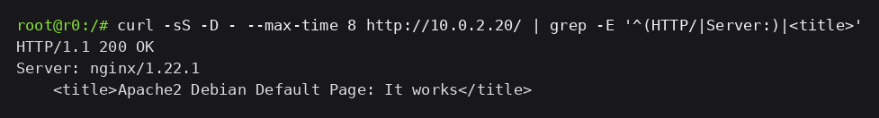
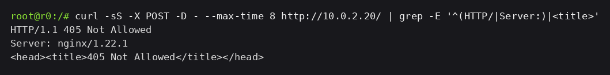
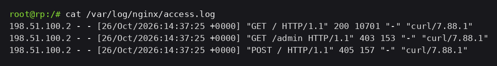

# Evidências — Dois controles no NGINX

O `rp` deixa de ser só encaminhador e vira barreira de aplicação: nega `/admin` para qualquer cliente e recusa método fora de `GET`/`HEAD`. Os dois controles acontecem antes de o pedido chegar ao `web`.

## 1. As duas respostas no web

Além do `index.html` na raiz, o `web` ganhou `web/var/www/html/admin/index.html`, uma página de 228 bytes. O `python3 -m http.server` serve os dois caminhos, e de dentro da DMZ os dois respondem:

```bash
curl -sSI --max-time 8 http://10.0.2.10/admin/   # no rp
```

```text
HTTP/1.0 200 OK
Server: SimpleHTTP/0.6 Python/3.11.2
Content-Length: 228
```



Isso importa para o teste: o `/admin` não bloqueia porque não existe, bloqueia porque o `rp` recusa.

## 2. Os controles no rp

`rp/etc/nginx/sites-enabled/default`, comentado diretiva por diretiva:

```nginx
# Controle de metodo: so GET e HEAD.
if ($request_method !~ ^(GET|HEAD)$) {
    return 405; # Method Not Allowed, gerado pelo rp, sem consultar o web
}

# Controle de caminho: /admin nao e publicado.
location = /admin {
    return 403; # Forbidden, gerado pelo rp, sem consultar o web
}
location /admin/ {
    return 403;
}
```



O `if` com `return` roda antes da resolução de `location`, então nenhum método fora dos dois autorizados chega a ser roteado. No caminho, a localização exata `= /admin` tem precedência sobre o prefixo `/`, e a variante `/admin/` está negada porque o servidor de arquivos do `web` responde esse caminho como diretório — negar só o exato deixaria essa porta aberta.

## 3. Os três testes, do lado de fora

No `r0`, cada pedido uma vez, mostrando status, `Server` e o título da resposta:

```bash
curl -sS -D - --max-time 8 http://10.0.2.20/ | grep -E '^(HTTP/|Server:)|<title>'
curl -sS -D - --max-time 8 http://10.0.2.20/admin | grep -E '^(HTTP/|Server:)|<title>'
curl -sS -X POST -D - --max-time 8 http://10.0.2.20/ | grep -E '^(HTTP/|Server:)|<title>'
```

| Pedido | Status | Quem respondeu |
| --- | --- | --- |
| `GET /` | 200 | `web` — o `index.html` de 10701 bytes |
| `GET /admin` | 403 | `rp` — página de erro do NGINX |
| `POST /` | 405 | `rp` — página de erro do NGINX |





Nos dois recusados o corpo é a página de erro padrão do NGINX, de 153 e 157 bytes. Quem respondeu foi o `rp`.

## 4. O que cada log registrou

No `rp`, com o log zerado antes da rodada, as três entradas:

```text
198.51.100.2 - - [26/Oct/2026:14:37:11 +0000] "GET / HTTP/1.1" 200 10701 "-" "curl/7.88.1"
198.51.100.2 - - [26/Oct/2026:14:37:11 +0000] "GET /admin HTTP/1.1" 403 153 "-" "curl/7.88.1"
198.51.100.2 - - [26/Oct/2026:14:37:11 +0000] "POST / HTTP/1.1" 405 157 "-" "curl/7.88.1"
```



No `web`, o mesmo período:

```text
10.0.2.20 - - [26/Oct/2026 14:37:11] "GET / HTTP/1.0" 200 -
```


Uma linha só. O `/admin` e o `POST` morreram no `rp` e nunca viraram requisição para o `web` — essa é a diferença entre o controle de aplicação e o encaminhamento puro.

## 5. O que o firewall não enxerga aqui

Os três pedidos são idênticos na camada 3 e 4: TCP/80, mesma origem `198.51.100.2`, mesmo destino `10.0.2.20`. Uma regra `--dport 80` não tem como separar `GET /` de `GET /admin` nem de `POST /`, porque método e caminho só existem na requisição HTTP. O `rp` é o primeiro ponto da topologia que lê esses campos, e por isso os dois controles estão nele.
