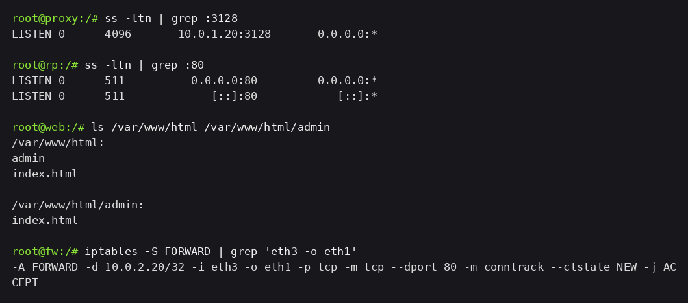
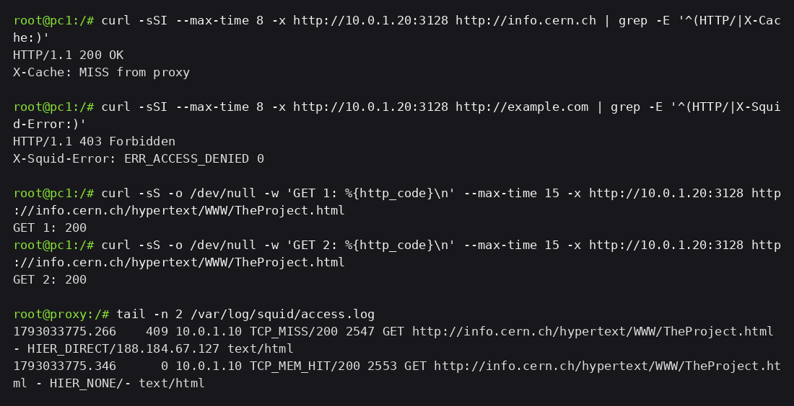
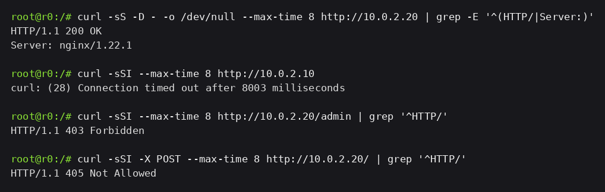

# Evidências — Reprodução com `kathara lstart` limpo

O lab foi derrubado e subido de novo a partir do repositório, sem passo manual:

```bash
kathara lclean -d .
kathara lstart --noterminals -d .
```

As imagens `kathara/proxy-squid` e `kathara/rp-nginx` já estavam construídas (`bash start.sh` faz o build). O que cada nó traz do repositório: `proxy/etc/squid/squid.conf`, `rp/etc/nginx/sites-enabled/default`, `web/var/www/html/` e as regras do `fw.startup`.

## 1. Serviços no boot

```bash
ss -ltn | grep :3128      # no proxy
ss -ltn | grep :80        # no rp
ls /var/www/html /var/www/html/admin   # no web
iptables -S FORWARD | grep 'eth3 -o eth1'   # no fw
```



Squid em `10.0.1.20:3128`, NGINX na 80, conteúdo do `web` copiado da pasta `web/` e a regra da `FORWARD` já restrita a `-d 10.0.2.20`. Nada foi instalado nem copiado à mão depois do start.

## 2. Squid

```bash
curl -sSI --max-time 8 -x http://10.0.1.20:3128 http://info.cern.ch
curl -sSI --max-time 8 -x http://10.0.1.20:3128 http://example.com
curl -sS -o /dev/null -w 'GET 1: %{http_code}\n' --max-time 15 -x http://10.0.1.20:3128 \
  http://info.cern.ch/hypertext/WWW/TheProject.html   # e o mesmo comando uma segunda vez
```



`200` no permitido, `403 ERR_ACCESS_DENIED` no bloqueado, e no log `TCP_MISS/200` seguido de `TCP_MEM_HIT/200` — o cache veio vazio do container novo e encheu na primeira busca, como esperado.

## 3. NGINX e o acesso direto

```bash
curl -sS -D - -o /dev/null --max-time 8 http://10.0.2.20      # no r0
curl -sSI --max-time 8 http://10.0.2.10                       # no r0
curl -sSI --max-time 8 http://10.0.2.20/admin                 # no r0
curl -sSI -X POST --max-time 8 http://10.0.2.20/              # no r0
```



Os sete testes reproduziram sem intervenção. As capturas das etapas 4 a 8 foram feitas em rodadas anteriores, então os timestamps dos logs diferem; os códigos e as ações são os mesmos.
